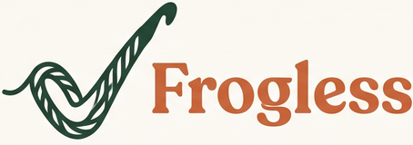
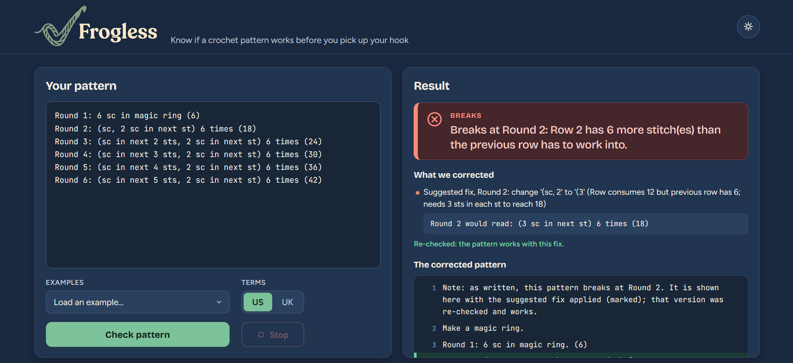
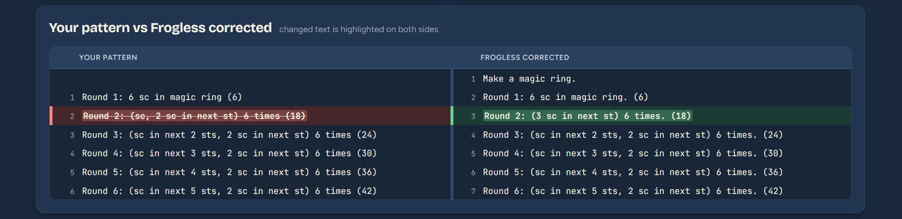
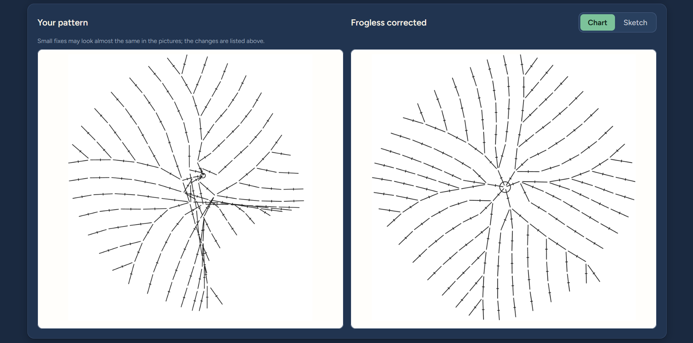
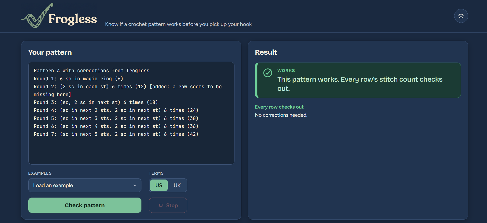
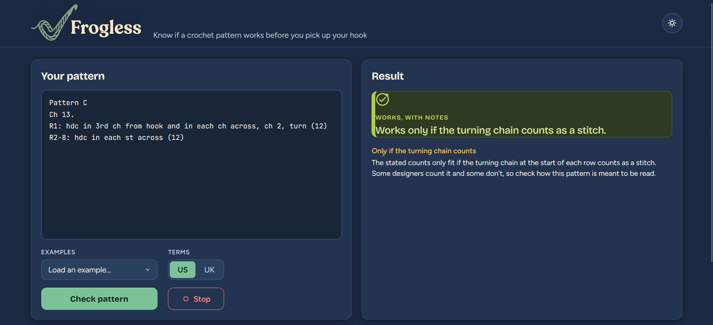
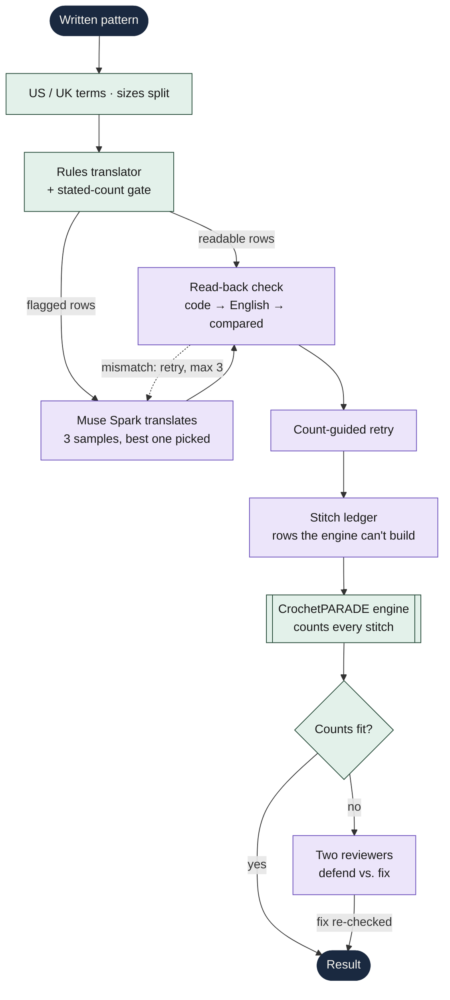
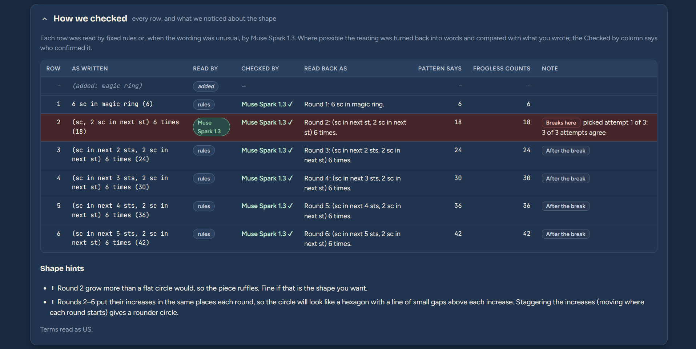
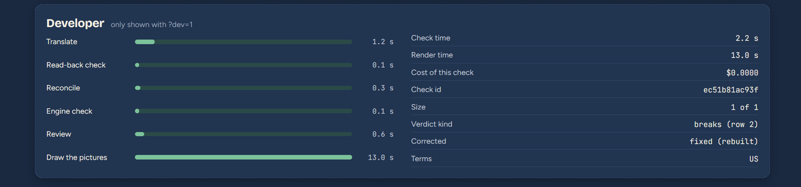

<p align="center">
  <picture>
    <source media="(prefers-color-scheme: dark)" srcset="frogless/web/static/img/logo-dark@2x.png">
    
  </picture>
</p>

<p align="center">
  <a href="LICENSE"></a>
</p>

# Frogless

Paste any crochet pattern. Know if it works before you pick up your hook: where it breaks, how to fix it, and what it will really make.

"Frogging" is ripping out crochet that went wrong. Frogless checks a written pattern stitch by stitch, so you find the mistake on paper instead of in your yarn.

**[▶ Watch the 3-minute demo](https://youtu.be/HVQ3V4vAZtc)**



## Contents

- [What it does](#what-it-does)
- [How it works](#how-it-works)
- [Setup](#setup)
  - [Requirements](#requirements)
  - [1. Clone Frogless](#1-clone-frogless)
  - [2. Clone CrochetPARADE](#2-clone-crochetparade-the-pattern-engine)
  - [3. Install the Python dependencies](#3-install-the-python-dependencies)
  - [3b. Visual rendering](#3b-visual-rendering)
  - [4. Create `.env`](#4-create-env)
  - [5. Check it works](#5-check-it-works)
- [Run the web page](#run-the-web-page)
- [Testing](#testing)
  - [Known-answer test bench](#known-answer-test-bench)
  - [Testing on real patterns](#testing-on-real-patterns)
- [Limits](#limits)
- [Built during the hackathon](#built-during-the-hackathon)
- [Prior work and dependencies](#prior-work-and-dependencies)
- [License](#license)

## What it does

- **Verdict:** works, breaks at row/round N, depends on a counting convention, or couldn't be read.
- **Stitch counts:** the count the pattern states next to the count its instructions really make, row by row.
- **Fixes:** a suggested correction for the broken row, and only fixes that pass the full check again are shown.
- **Corrected pattern and pictures:** your pattern and the corrected one side by side, with a stitch chart for each.
- **Shape hints:** whether a piece will lie flat, cup, ruffle or close into a ball.

**Your pattern and the corrected one, with the change marked on both sides**



**What each one makes, stitch by stitch** (charts drawn by CrochetPARADE)



**A pattern that works**




**A pattern that depends on how you count**



## How it works



> NOTE: Purple steps use Muse Spark. Green steps are our rules and the stitch engine.

The model reads and suggests; plain code and the stitch engine decide. A fix is shown only after it passes the same checks as the original.

**Meta models used:** Muse Spark (`muse-spark-1.3`) for translation, faithfulness checks, counting rows the engine can't model, and the two reviews. A SAM 3.1 client (`frogless/models/`) is built and tested for photo features, which the current app doesn't use yet.

**How we checked** (add `?dev=1` to the address): every row, who read it, and who confirmed the reading



**Timings and cost of each check**



## Setup

### Requirements
- Python 3.12+
- Node.js 20+ (tested on 24). The pattern engine is JavaScript and runs through Node.
- Git
- A Meta Model API key from https://dev.meta.ai

### 1. Clone Frogless
```sh
git clone https://github.com/krawal19/Frogless.git
cd Frogless
```

### 2. Clone CrochetPARADE (the pattern engine)
Clone it anywhere you like, and pin it to the commit Frogless is tested against:
```sh
git clone https://github.com/stassev/CrochetPARADE.git
cd CrochetPARADE
git checkout 06e987b
cd ..
```

### 3. Install the Python dependencies
```sh
python -m venv .venv
# Windows
.venv\Scripts\activate
# macOS / Linux
source .venv/bin/activate

pip install -r requirements.txt
```

### 3b. Visual rendering
Needed to draw charts and 3D views (the web page's pictures, `scripts/check.py --chart`, `python -m scripts.render_samples`). Tests do not need it.
```sh
python -m playwright install chromium
```
Output goes to `logs/renders/index.html`.

### 4. Create `.env`
Copy the template and fill in both values:
```sh
cp .env.example .env
```
```ini
META_API_KEY=your-key-here
CROCHETPARADE_PATH=/absolute/path/to/CrochetPARADE
```
On Windows, use forward slashes, for example `C:/code/CrochetPARADE`. `.env` is gitignored, so don't commit it.

### 5. Check it works
```sh
python -m pytest -q        # offline, no API calls
python -m scripts.hello    # one Muse Spark call, under 1 cent
```
Every model call is logged with its cost to `logs/model_calls.jsonl`.

## Run the web page

After the setup above:
```sh
python -m frogless.web
```
Open http://127.0.0.1:7860, paste a pattern (or pick an example), choose US or UK terms, and press **Check pattern**. Add `?dev=1` to the address for a row-by-row "How we checked" panel, timings and cost.

> Note: Clear browser cache if page seem to be stuck

From the command line:
```sh
python -m scripts.check path/to/pattern.txt --clean --chart
```

## Testing

### Known-answer test bench
```sh
python -m scripts.run_testset
```
Generates circles, balls and flat pieces whose correct stitch counts are known by arithmetic, plus copies with planted mistakes (wrong count, missing round, impossible increase). Each case runs two ways, from engine code and from written English, and is scored PASS / FAIL / UNREADABLE. Settings are in `config/testset.json`. No model calls.

### Testing on real patterns
We also test on real crochet patterns that are freely available online. They belong to their designers, so we don't redistribute them: they live in a local `external_patterns/` folder that is gitignored. Results are reported as totals only.

To try your own, put each pattern in a plain `.txt` file in any folder and run:
```sh
python -m scripts.run_testset --patterns path/to/folder
python -m scripts.run_testset --patterns path/to/folder --summary-only   # totals only
```

## Limits

- **Constructions the engine can't draw** (legs worked back along a chain followed by more rounds, joining two pieces, spike stitches) are checked by stitch count only, and the verdict says so.
- **Counting conventions differ between designers** (does a turning chain count as a stitch? are chain spaces in the total?). Frogless uses common defaults confirmed with an experienced crocheter, tries the other reading when the pattern's own counts point to it, and says "depends on how you count" when both fit.
- **US vs UK terms** are chosen by you. Frogless warns when the pattern doesn't say, or looks like the other system.
- **Pictures:** the 3D view is reliable for 3D pieces (balls, tubes) but not for flat pieces; the symbol chart is reliable for rounds and squares and rough for flat rows.
- **Model answers vary.** Hard rows are translated three times and the code picks; a few hard patterns can still come out differently between runs.
- **One round per line, one piece per check.** Several rounds written on one line, or several pieces (body, arms, feet) pasted together, aren't read correctly yet; check each piece on its own, one round per line.
- **Ovals worked around both sides of a chain** ("3 sc in last ch, rotate, sc along the other side") are misread and can come out as a false "breaks".
- **Starting chains:** a row like "hdc in 3rd ch from hook" can occasionally be read as skipping one chain fewer, so that it matches the stated count instead of saying it only works if the turning chain counts.
- **Synthetic test bench:** at the last full run of all 81 cases (Oct 28), 39 of 40 planted mistakes were caught at the right row (the other came out as "depends on how you count") and all 41 correct patterns were judged correct. The checker was tuned after that run. On Nov 2, the 38 correct test-bench patterns shipped in `examples/general/` and the demo patterns in `examples/demo/` were checked again with the current version: the expected verdict on every one except the starting-chain case above, for $2.03 in model calls.

## Built during the hackathon

Everything in this repository was written during the Meta Global AI Developer Hackathon (Oct 26 to Nov 4, 2026): the pipeline in `frogless/` (translation, faithfulness check, referee, review, stitch-count ledger, shape hints, US/UK and multi-size handling), the engine adapter and stitch-graph count checks, the notation guide, the test bench and its generators, the web page, and all tests.

## Prior work and dependencies

- **CrochetPARADE** (GPLv3): the crochet pattern language, renderer and stitch-graph engine Frogless checks patterns with. Used as an external dependency through a local clone (see Setup); not modified. Frogless's engine adapter, count checks and everything around it are new.
- **meta-sam-parser** (SAM License): parses SAM 3.1 segmentation output.
- Python: FastAPI, uvicorn, httpx, python-dotenv, Pillow, Playwright, pytest. Web page: React and Babel from a CDN, Google Fonts.
- Related research, which translates or analyses crochet patterns with language models but does not run an engine-feedback loop to check whether a user's pattern works:
  - "Translation of User Crochet Patterns to CrochetPARADE syntax using LLMs" (AAAI Spring Symposium, 2025)
  - "Analysis and Visualization of AI-generated Amigurumi Crochet Patterns" (2025)
  - "CrochetBench" (2025)

## License

GPLv3 (see `LICENSE`), matching CrochetPARADE.
